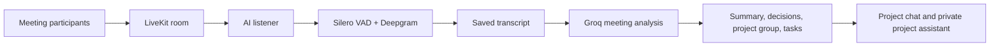

# AI Meeting Management

<p align="center">
  <strong>Meet, understand what was decided, and keep project work moving.</strong>
</p>

<p align="center">
  
  
  
  
</p>

AI Meeting Management is a web app for scheduling and joining live meetings, capturing speech transcripts, and turning meeting conversations into summaries, decisions, project groups, and assigned tasks.

## What it does

- **Accounts:** Register and sign in with a unique email address.
- **Employee profiles:** Add a department, role, skills, experience, and a PDF, DOCX, or TXT resume for your private Project AI assistant.
- **Meetings:** Schedule meetings, invite participants with a link, and join from a browser.
- **Live meeting tools:** Audio, camera, screen sharing, participant list, meeting chat, and presentation pinning.
- **AI meeting listener:** A LiveKit agent joins the room and transcribes speech. Meeting audio and video are not stored.
- **Meeting follow-up:** When the organizer ends a meeting, Groq can generate a summary, key points, decisions, project details, and action items with owners and due dates when supported by the transcript.
- **Project groups:** Meeting participants can continue in a shared project chat, with member management and unread message counts.
- **Project assistant:** Each group member has a private AI chat. PostgreSQL full-text search and optional semantic vector search retrieve relevant meeting summaries, transcript passages, project chat messages, and action items. Current task records are also fetched directly from the project database. Answers cite the project sources they use.
- **Daily updates:** Employees submit a dated update for each project with their account email, project ID, current focus, completed work, remaining work, blockers, and optional hours. They can record a no-work day. Project administrators can see submissions and which project members have not reported.
- **Admin workspace:** App administrators sign in through the same login as employees. Their sidebar includes an employee directory with private profile, project, assigned-task, and daily-update pages. Employees cannot browse these admin pages or view another employee's daily submissions.
- **Company AI:** Administrators can ask company-wide questions about employee profiles, daily submissions, projects, meeting records, tasks, and blockers. The assistant retrieves relevant company records and uses Groq to prepare a grounded answer.
- **Database options:** SQLite for a quick local start, or PostgreSQL for a shared development database.

## How the AI workflow fits together



## Requirements

- Python 3.13 (the project environment was created with Python 3.13)
- A LiveKit Cloud project or reachable self-hosted LiveKit server
- Deepgram API key for speech transcription
- Groq API key for meeting summaries, task extraction, and project AI chat
- OpenAI API key for semantic embeddings (Groq remains the chat model)
- PostgreSQL only if you choose PostgreSQL instead of the default SQLite setup
- The pgvector PostgreSQL extension to enable semantic search

## Quick start on Windows

Open PowerShell in the project directory:

```powershell
py -3.13 -m venv .venv
Set-ExecutionPolicy -Scope Process Bypass
.\.venv\Scripts\Activate.ps1
python -m pip install --upgrade pip
python -m pip install -r requirements.txt
Copy-Item .env.example .env
```

Edit `.env` and set a private Django secret key. You can generate one with:

```powershell
python -c "import secrets; print(secrets.token_urlsafe(50))"
```

Then run the database migrations and start Django:

```powershell
python manage.py migrate
python manage.py createsuperuser
python manage.py runserver
```

Open [http://127.0.0.1:8000](http://127.0.0.1:8000). Register an account or sign in with the admin account you created. The Django admin is at `/admin/`.

## Configure meetings and AI

Set these values in `.env`:

| Variable | Purpose |
| --- | --- |
| `DJANGO_SECRET_KEY` | Django session and security signing key. Keep it private. |
| `LIVEKIT_URL` | WebSocket URL for your LiveKit server. |
| `LIVEKIT_API_KEY` | LiveKit API key used to create room tokens. |
| `LIVEKIT_API_SECRET` | Matching LiveKit API secret. |
| `DEEPGRAM_API_KEY` | Speech-to-text service used by the meeting listener. |
| `GROQ_API_KEY` | Groq key used for meeting reports and project AI. |
| `GROQ_MODEL` | Optional model override; defaults to `openai/gpt-oss-120b`. |
| `OPENAI_API_KEY` | OpenAI key used only to create semantic search embeddings. |
| `DB_ENGINE` | `sqlite` by default; set to `postgresql` to use PostgreSQL. |

Keep `.env` private and never commit it. `.env.example` is the safe template to share; put only blank values or non-secret defaults in that file.

### Start the AI listener

The web app and listener run as separate processes. After configuring LiveKit and Deepgram, open another PowerShell window in the project directory and run:

```powershell
.\.venv\Scripts\python.exe agent\worker.py dev
```

Keep the listener running while meetings are active. It joins rooms through LiveKit, applies Silero voice activity detection, and sends speech to Deepgram for transcription. When an organizer ends a meeting, the app uses the saved transcript to create the AI report and project follow-up.

### Automatically end meetings at their deadline

Run this command in another PowerShell window so end times are enforced even when nobody has the meeting page open:

```powershell
.\.venv\Scripts\python.exe manage.py expire_meetings
```

The checker polls every 15 seconds by default. You can choose a different polling interval with `--interval 5`. If this process is not running, the app still rejects a late join and marks an expired meeting ended the next time a user opens the dashboard, meeting list, meeting page, or join link.

### Use PostgreSQL

The default configuration uses the local `db.sqlite3` file. To use PostgreSQL, create a database and application role, then set these values in `.env`:

```dotenv
DB_ENGINE=postgresql
POSTGRES_DB=meeting_ai
POSTGRES_USER=meeting_ai_app
POSTGRES_PASSWORD=your-local-database-password
POSTGRES_HOST=localhost
POSTGRES_PORT=5432
```

Make sure PostgreSQL is running and the role has access to the database, then apply migrations:

```powershell
python manage.py migrate
```

Switching `DB_ENGINE` changes which database Django connects to; it does not copy data between SQLite and PostgreSQL.

PostgreSQL full-text search remains available as a fallback. Semantic vector search uses OpenAI's `text-embedding-3-small` embeddings with pgvector; it is enabled when `OPENAI_API_KEY` is set and the `vector` extension is installed in the active database. If either is missing, the project assistant continues using full-text search. SQLite supports local tests but does not run semantic vector queries.

#### Enable semantic vector search

Install the pgvector extension files for the same PostgreSQL version used by this project, then connect to the `meeting_ai` database as a database owner and run:

```sql
CREATE EXTENSION IF NOT EXISTS vector;
```

Add `OPENAI_API_KEY=...` to `.env` (never commit or paste the key into chat), restart Django, and ask a question in a project group. On the first query, the app creates embeddings for that project's meeting summaries, transcripts, project chat, and action items; later queries reuse the saved embeddings and update changed sources. Daily updates are available to project administrators on the Team updates page; they are intentionally not exposed to ordinary project group assistants.

For a Windows PostgreSQL installation, pgvector must be installed for the matching PostgreSQL major version before the SQL command above will work. The official pgvector project documents Windows compilation using Visual Studio C++ Build Tools and `nmake`: [pgvector installation instructions](https://github.com/pgvector/pgvector#installation-notes---windows). PostgreSQL 14 requires the pgvector files built for PostgreSQL 14.

## Test from another device

Camera and microphone access on phones and other computers requires HTTPS. For a temporary local test, run Django and expose it through a trusted HTTPS tunnel such as [Cloudflare Tunnel](https://developers.cloudflare.com/cloudflare-one/networks/connectors/cloudflare-tunnel/). Configure `DJANGO_ALLOWED_HOSTS`, `DJANGO_CSRF_TRUSTED_ORIGINS`, and `DJANGO_TRUST_PROXY_SSL` for the tunnel URL, then open that HTTPS address on both devices. Stop the tunnel after testing; its temporary URL gives access to your local app while it is running.

## Project layout

```text
agent/                  LiveKit meeting listener
apps/accounts/          Registration, email login, and user profiles
apps/meetings/          Meetings, transcripts, AI reports, and action items
apps/projects/          Project groups, chats, and project AI
config/                 Django settings and URL configuration
templates/              Django HTML templates
scripts/                Synthetic Groq meeting demo
```

## Privacy and deployment notes

- Meeting audio and video are streamed through LiveKit; this app does not save the media.
- Speech transcripts and AI-generated meeting reports are saved in the configured database.
- Daily work submissions and employee details are visible in the app only to authorized app administrators; submitted work is not shown in other employees' views or project chats.
- Company AI sends the relevant records retrieved for an administrator's question to Groq for answer generation. Project AI is restricted to the selected project group and its members; employees cannot retrieve another project's records by asking about it.
- Project AI sends the current employee's professional profile and extracted resume text to Groq when that employee asks Project AI for help; it stays within that employee's selected project context. Company AI sends relevant employee details, daily submissions, and project records to Groq when an authorized admin asks a question.
- Keep API keys, database passwords, and `DJANGO_SECRET_KEY` out of source control.
- Before deploying publicly, configure a strong secret key, `DJANGO_DEBUG=False`, production hosts and HTTPS settings, and a production-grade database. The development server is for local use only.

